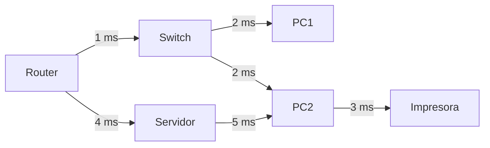

# Reto Práctico: "La red del laboratorio"

**Universidad Técnica de Ambato · FISEI · Ingeniería de Software**
**Asignatura:** Estructura de Datos · **Nivel:** III "B" · **Docente:** Ing. José Rubén Caiza Caizabuano
**Unidad 4:** Grafos (grafo dirigido con multilistas en Java)

🔗 **Repositorio:** [https://github.com/juanchicoyunda1234/RetoPractico-RedLaboratorio-Grafos](https://github.com/juanchicoyunda1234/RetoPractico-RedLaboratorio-Grafos)

---

## 👥 Integrantes

| Integrante | Usuario GitHub | Rol |
|---|---|---|
| Chico Yunda Juan Carlos | juanchicoyunda1234 | Líder, integración final, casos de prueba y README |
| Torosina Armendariz Jeremy | WinoSpop | Modificación y eliminación de enlaces, diagrama |
| Altamirano Segovia Jullisa | jullisaaltamirano2017-boop | Documentación, respuestas y capturas |
| Romo Nunez Joseph | wayusa25-cmyk | Backend modelo (Vertice, Arista) |
| Llamuca Abrajan Andres | llamucaandres161 | Backend negocio (Grafo) |
| Tuza Quinatoa Noemi | edithtuza15-collab | Recorrido BFS, cola y grado |

---

## 📋 Enunciado

**Reto:** "La red del laboratorio"

Representen esta red como un grafo dirigido con multilistas, usando solo `Vertice`, `Arista` y `Grafo`. No se puede usar `HashMap`, `ArrayList` ni librerías de grafos.

- **Equipos:** Router, Switch, PC1, PC2, Impresora, Servidor
- **Enlaces (latencia en ms):** Router → Switch (1), Router → Servidor (4), Switch → PC1 (2), Switch → PC2 (2), PC2 → Impresora (3), Servidor → PC2 (5)

1. **Construir:** inserten los equipos y los enlaces, y llamen a `mostrar()`. Prueben que agregar "Router" otra vez y agregar PC1 → Proyector (3) devuelvan `false`.
2. **Consultar:** ejecuten `bfs("Router")`. Programen `grado(id)`, que devuelve -1 si el equipo no existe. Cambien la latencia de Router → Servidor a 2 y eliminen Servidor → PC2.
3. **Decidir:** el Switch se dañó. Elimínenlo y verifiquen con `esConexo("Router")`. ¿Qué equipos quedaron aislados? ¿Cuántos enlaces nuevos hacen falta, como mínimo, para reconectarlos? Agréguenlos y comprueben.

**Entrega:** capturas de la consola, el código de `grado(id)` y las respuestas de la parte 3, subir al GitHub.

## 🗺️ Red inicial

