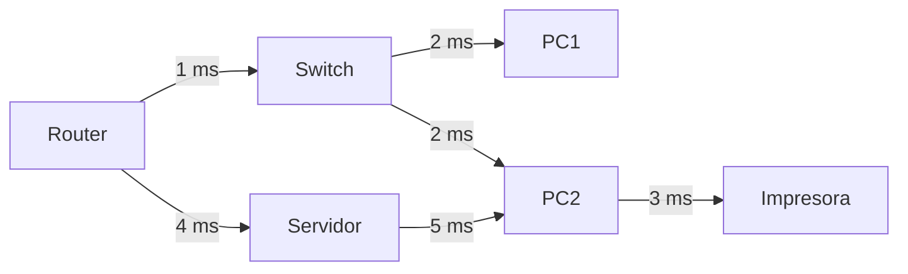
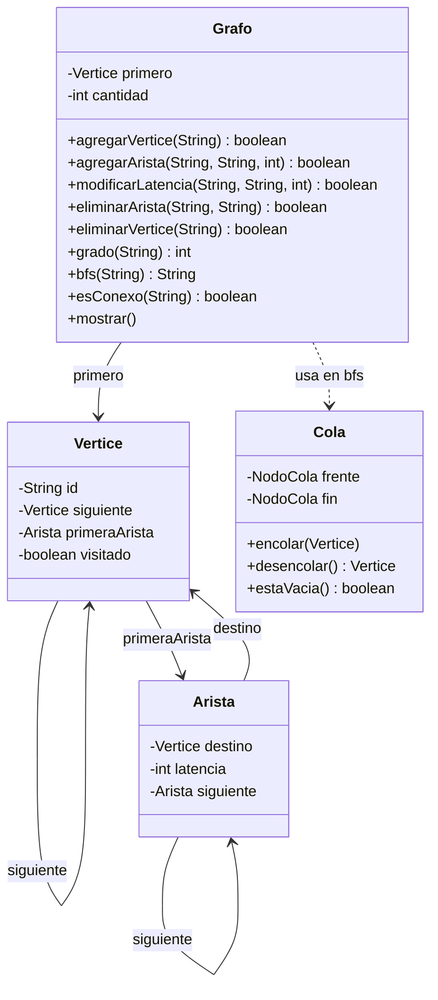
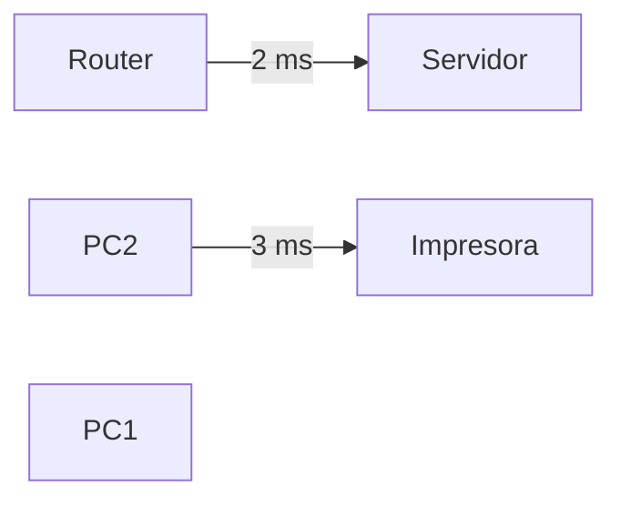
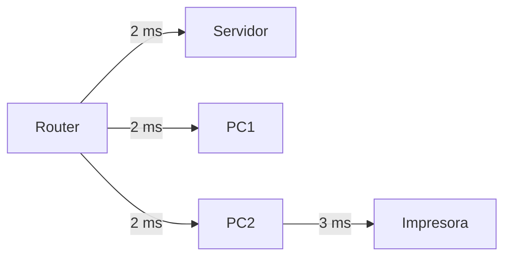
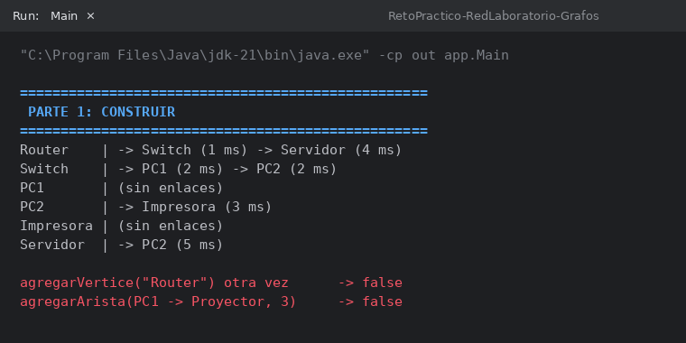
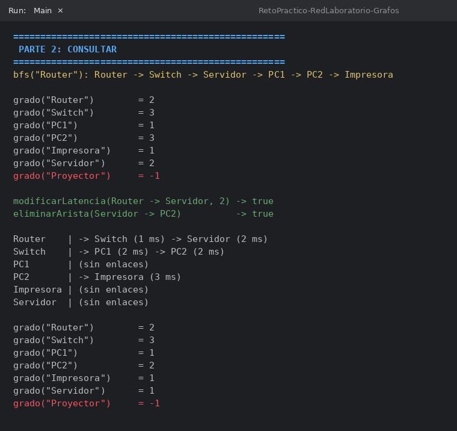
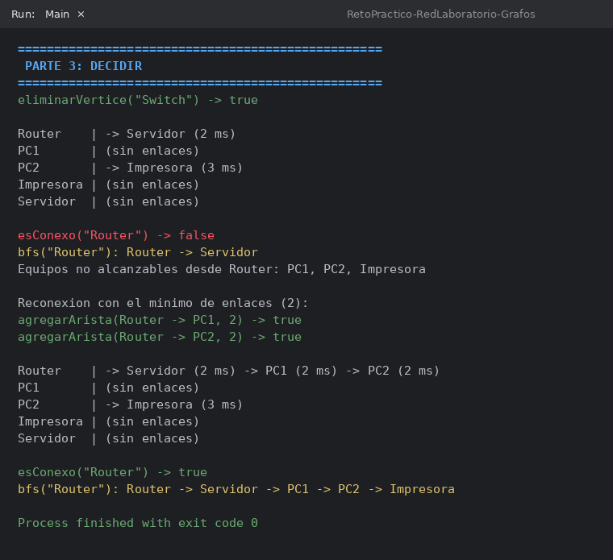

# Reto Práctico: "La red del laboratorio"

**Universidad Técnica de Ambato · FISEI · Ingeniería de Software**
**Asignatura:** Estructura de Datos · **Nivel:** III "B" · **Docente:** Ing. José Rubén Caiza Caizabuano
**Unidad 4:** Grafos (grafo dirigido con multilistas en Java)

🔗 **Repositorio:** [https://github.com/juanchicoyunda1234/RetoPractico-RedLaboratorio-Grafos](https://github.com/juanchicoyunda1234/RetoPractico-RedLaboratorio-Grafos)

---

## 👥 Integrantes

| Integrante | Usuario GitHub | Rol |
|---|---|---|
| Chico Yunda Juan Carlos | juanchicoyunda1234 | Líder, integración final, casos de prueba y README |
| Torosina Armendariz Jeremy | WinoSpop | Modificación y eliminación de enlaces, diagrama |
| Altamirano Segovia Jullisa | jullisaaltamirano2017-boop | Documentación, respuestas y capturas |
| Romo Nunez Joseph | wayusa25-cmyk | Backend modelo (Vertice, Arista) |
| Llamuca Abrajan Andres | llamucaandres161 | Backend negocio (Grafo) |
| Tuza Quinatoa Noemi | edithtuza15-collab | Recorrido BFS, cola y grado |

---

## 📋 Enunciado

**Reto:** "La red del laboratorio"

Representen esta red como un grafo dirigido con multilistas, usando solo `Vertice`, `Arista` y `Grafo`. No se puede usar `HashMap`, `ArrayList` ni librerías de grafos.

- **Equipos:** Router, Switch, PC1, PC2, Impresora, Servidor
- **Enlaces (latencia en ms):** Router → Switch (1), Router → Servidor (4), Switch → PC1 (2), Switch → PC2 (2), PC2 → Impresora (3), Servidor → PC2 (5)

1. **Construir:** inserten los equipos y los enlaces, y llamen a `mostrar()`. Prueben que agregar "Router" otra vez y agregar PC1 → Proyector (3) devuelvan `false`.
2. **Consultar:** ejecuten `bfs("Router")`. Programen `grado(id)`, que devuelve -1 si el equipo no existe. Cambien la latencia de Router → Servidor a 2 y eliminen Servidor → PC2.
3. **Decidir:** el Switch se dañó. Elimínenlo y verifiquen con `esConexo("Router")`. ¿Qué equipos quedaron aislados? ¿Cuántos enlaces nuevos hacen falta, como mínimo, para reconectarlos? Agréguenlos y comprueben.

**Entrega:** capturas de la consola, el código de `grado(id)` y las respuestas de la parte 3, subir al GitHub.

---

## 🗺️ Red inicial



## 🧱 Representación con multilistas

Cada `Vertice` está en una lista enlazada de vértices (`siguiente`) y tiene su propia lista enlazada de aristas de salida (`primeraArista`). Cada `Arista` guarda el vértice `destino`, la `latencia` y la `siguiente` arista del mismo origen. No se usa ninguna colección de Java: la cola del BFS (`Cola`) también es propia, con nodos enlazados.



---

## 📁 Estructura del proyecto

```
RetoPractico-RedLaboratorio-Grafos/
├── src/
│   ├── modelo/
│   │   ├── Vertice.java
│   │   └── Arista.java
│   ├── negocio/
│   │   ├── Cola.java
│   │   └── Grafo.java
│   └── app/
│       └── Main.java
├── capturas/
├── .gitignore
└── README.md
```

## ▶️ Cómo ejecutar

Desde IntelliJ IDEA: marcar `src` como *Sources Root* y ejecutar `app.Main`.

Desde consola:

```bash
javac -d out src/modelo/*.java src/negocio/*.java src/app/*.java
java -cp out app.Main
```

---

## 🔢 Código de `grado(id)`

En un grafo dirigido el grado de un equipo es la suma de sus enlaces de **entrada** (cuántos equipos apuntan a él) y de **salida** (a cuántos apunta él). Si el equipo no existe devuelve -1.

```java
    public int grado(String id) {
        Vertice v = buscar(id);
        if (v == null) {
            return -1;
        }
        int salida = 0;
        Arista a = v.getPrimeraArista();
        while (a != null) {
            salida++;
            a = a.getSiguiente();
        }
        int entrada = 0;
        Vertice actual = primero;
        while (actual != null) {
            if (buscarArista(actual, id) != null) {
                entrada++;
            }
            actual = actual.getSiguiente();
        }
        return entrada + salida;
    }
```

| Equipo | Entrada | Salida | Grado inicial | Grado tras la parte 2 |
|---|---|---|---|---|
| Router | 0 | 2 | 2 | 2 |
| Switch | 1 | 2 | 3 | 3 |
| Servidor | 1 | 1 | 2 | 1 |
| PC1 | 1 | 0 | 1 | 1 |
| PC2 | 2 | 1 | 3 | 2 |
| Impresora | 1 | 0 | 1 | 1 |
| Proyector | : | : | -1 | -1 |

---

## ✅ Respuestas

### Parte 1: Construir

- `agregarVertice("Router")` por segunda vez devuelve **false**: antes de insertar, el método busca el id en la lista de vértices y no admite duplicados.
- `agregarArista("PC1", "Proyector", 3)` devuelve **false**: el método busca los dos extremos y `Proyector` no existe en el grafo.

### Parte 2: Consultar

- `bfs("Router")` = **Router → Switch → Servidor → PC1 → PC2 → Impresora**. Primero se visitan los vecinos directos del Router (Switch y Servidor, en el orden en que se insertaron las aristas), luego los vecinos de esos (PC1 y PC2; PC2 no se repite al llegar desde Servidor porque ya está marcado como visitado) y al final Impresora.
- `grado(id)`: ver la tabla anterior. `grado("Proyector")` = -1.
- La latencia de Router → Servidor pasa de 4 a **2 ms** y el enlace Servidor → PC2 se elimina (los dos métodos devuelven true).

### Parte 3: Decidir

**Al eliminar el Switch** se borra el vértice y también todos los enlaces que lo tocaban: los de salida (Switch → PC1, Switch → PC2) desaparecen con él, y el de entrada (Router → Switch) se elimina recorriendo las listas de aristas de los demás vértices. La red queda así:



**1. ¿Es conexo?** `esConexo("Router")` = **false**. Desde el Router solo se alcanza al Servidor (2 de 5 equipos).

**2. ¿Qué equipos quedaron aislados?** **PC1, PC2 e Impresora** quedaron aislados del Router (no se los puede alcanzar). PC1 quedó totalmente aislado, sin ningún enlace; PC2 e Impresora siguen conectados entre sí, pero sin camino desde el Router.

**3. ¿Cuántos enlaces nuevos hacen falta, como mínimo?** **2 enlaces.** Quedaron dos grupos separados del Router: {PC1} y {PC2, Impresora}. Un solo enlace no alcanza: si llega a PC1, PC1 no tiene salidas; si llega a PC2, desde PC2 solo se llega a Impresora. Hace falta un enlace por cada grupo. Se agregaron **Router → PC1 (2 ms)** y **Router → PC2 (2 ms)**, es decir, las PCs se conectan directo al Router como reemplazo del Switch. Con eso `esConexo("Router")` = **true** y el BFS recorre los 5 equipos: Router → Servidor → PC1 → PC2 → Impresora.



---

## 🖥️ Salida de la consola

```
==================================================
 PARTE 1: CONSTRUIR
==================================================
Router    | -> Switch (1 ms) -> Servidor (4 ms)
Switch    | -> PC1 (2 ms) -> PC2 (2 ms)
PC1       | (sin enlaces)
PC2       | -> Impresora (3 ms)
Impresora | (sin enlaces)
Servidor  | -> PC2 (5 ms)

agregarVertice("Router") otra vez      -> false
agregarArista(PC1 -> Proyector, 3)     -> false

==================================================
 PARTE 2: CONSULTAR
==================================================
bfs("Router"): Router -> Switch -> Servidor -> PC1 -> PC2 -> Impresora

grado("Router")        = 2
grado("Switch")        = 3
grado("PC1")           = 1
grado("PC2")           = 3
grado("Impresora")     = 1
grado("Servidor")      = 2
grado("Proyector")     = -1

modificarLatencia(Router -> Servidor, 2) -> true
eliminarArista(Servidor -> PC2)          -> true

Router    | -> Switch (1 ms) -> Servidor (2 ms)
Switch    | -> PC1 (2 ms) -> PC2 (2 ms)
PC1       | (sin enlaces)
PC2       | -> Impresora (3 ms)
Impresora | (sin enlaces)
Servidor  | (sin enlaces)

grado("Router")        = 2
grado("Switch")        = 3
grado("PC1")           = 1
grado("PC2")           = 2
grado("Impresora")     = 1
grado("Servidor")      = 1
grado("Proyector")     = -1

==================================================
 PARTE 3: DECIDIR
==================================================
eliminarVertice("Switch") -> true

Router    | -> Servidor (2 ms)
PC1       | (sin enlaces)
PC2       | -> Impresora (3 ms)
Impresora | (sin enlaces)
Servidor  | (sin enlaces)

esConexo("Router") -> false
bfs("Router"): Router -> Servidor
Equipos no alcanzables desde Router: PC1, PC2, Impresora

Reconexion con el minimo de enlaces (2):
agregarArista(Router -> PC1, 2) -> true
agregarArista(Router -> PC2, 2) -> true

Router    | -> Servidor (2 ms) -> PC1 (2 ms) -> PC2 (2 ms)
PC1       | (sin enlaces)
PC2       | -> Impresora (3 ms)
Impresora | (sin enlaces)
Servidor  | (sin enlaces)

esConexo("Router") -> true
bfs("Router"): Router -> Servidor -> PC1 -> PC2 -> Impresora
```

## 📸 Capturas

### Parte 1: Construir

🔗 [Ver captura en GitHub](https://github.com/juanchicoyunda1234/RetoPractico-RedLaboratorio-Grafos/blob/main/capturas/parte1.png)



### Parte 2: Consultar

🔗 [Ver captura en GitHub](https://github.com/juanchicoyunda1234/RetoPractico-RedLaboratorio-Grafos/blob/main/capturas/parte2.png)



### Parte 3: Decidir

🔗 [Ver captura en GitHub](https://github.com/juanchicoyunda1234/RetoPractico-RedLaboratorio-Grafos/blob/main/capturas/parte3.png)



---

## 💡 Conclusiones

- La multilista permite representar un grafo dirigido sin colecciones de Java: cada vértice guarda su propia lista de aristas, así que agregar un enlace solo toca la lista del origen.
- El grado de entrada no se guarda en ningún lado: hay que recorrer las aristas de todos los vértices. Lo mismo pasa al eliminar un vértice, que obliga a limpiar los enlaces que entraban en él para no dejar aristas apuntando a un equipo que ya no existe.
- `esConexo` se resuelve con el mismo BFS: si la cantidad de vértices visitados es igual al total, todos son alcanzables. En la red del laboratorio el Switch era un punto único de falla.
